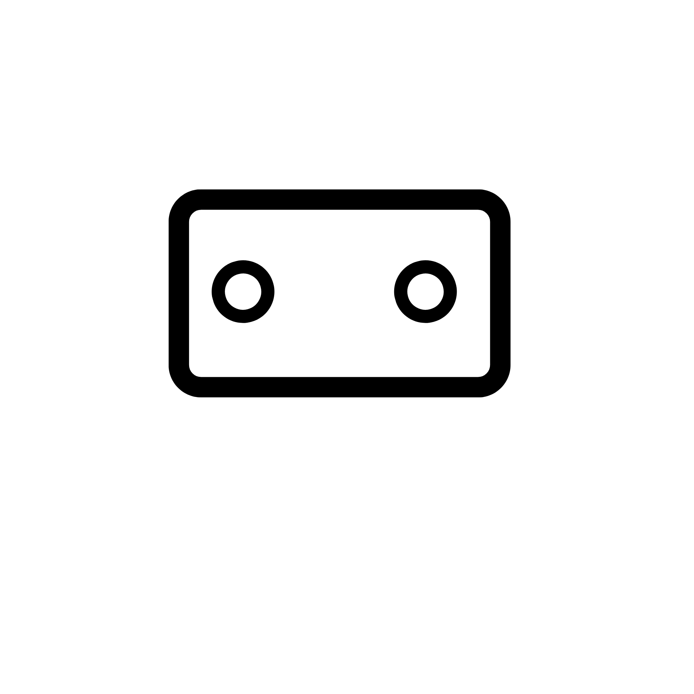

<p align="center">
  
</p>

<h1 align="center">AgenticVM</h1>

<p align="center">Local virtual desktops for agents, with a shared CLI, MCP bridge and Windows desktop app.</p>

AgenticVM brings Linux, Android and Windows guest control behind a local control layer. Agents can target a guest explicitly, work through a scoped host exchange folder, and use the same lifecycle, file, input and job controls through CLI or stdio MCP.

This is the **0.4.0 beta source tree**. It contains the Python control service, browser interface, native .NET desktop shell, guest helpers and regression tests. Native guest support and experimental lab modules have different acceptance limits; the presence of an adapter does not establish native acceptance for every platform.

## What is included

- A Windows desktop shell using WinForms and WebView2.
- A local browser interface for guest navigation and control.
- Shared CLI and MCP control, explicit guest/session targeting and scoped file exchange.
- Resource admission, ownership checks, job limits and recovery/checkpoint code.
- Linux, Android and Windows guest helpers, plus experimental owner-prepared garden/enrollment labs.
- Source, tests and pinned dependency metadata for preparing a local development environment.

## Start with the source

Use Windows for the native desktop and guest integration work. Python 3.13 is the development baseline; .NET 9 and WebView2 are used by the desktop shell.

```powershell
git clone https://github.com/juniper234/agenticvm.git
cd agenticvm
py -3.13 -m venv .venv
.\.venv\Scripts\python.exe -m pip install -e .
.\.venv\Scripts\agenticvm-control.exe --help
.\.venv\Scripts\agenticvm-desktop-mcp.exe --help
```

Guest images, QEMU, Android SDK components, Windows evaluation media, local models and downloaded build tools are separate prerequisites. Their preparation scripts and lock metadata are included where available. A clone is a source checkout, not a complete portable runtime bundle. Start with [development and builds](docs/DEVELOPMENT.md).

## Agent control

The Python package provides `agenticvm`, `agenticvm-control` and `agenticvm-desktop-mcp` commands. The last exposes the desktop control layer over stdio MCP. [mcp.desktop.example.json](mcp.desktop.example.json) uses placeholder paths; adapt those paths to your own checkout and selected workspace.

The local service uses private admission information. Its generated state belongs in the local runtime directory. Existing Windows launchers target the prepared portable layout and expect its bundled runtime to have been prepared first.

## Test

```powershell
.\.venv\Scripts\python.exe -m unittest discover -s tests -v
```

Some platform or optional dependency checks require their corresponding tools and permissions. The host suite is separate from native VM campaigns, physical-device testing and resource measurements on a 4 GB host. See [verification](docs/VERIFICATION.md) for this publication's measured results and limits.

## Project layout

| Path | Contents |
| --- | --- |
| `src/agenticvm/` | Control service, CLI/MCP adapters, guest backends and local web interface |
| `desktop/` | Native Windows desktop shell, setup source and backend entry point |
| `guest/` | Guest control helpers and lab source |
| `scripts/` | Build, preparation, packaging and verification source |
| `tests/` | Host regression and interface checks |
| `tools/*-lock.json` | Pinned upstream dependency metadata |

## References

AgenticVM works with [QEMU](https://www.qemu.org/), [Python](https://www.python.org/), [Android](https://source.android.com/) and [.NET](https://dotnet.microsoft.com/). The desktop shell uses [Microsoft WebView2](https://learn.microsoft.com/microsoft-edge/webview2/). The web interface's Lucide icons retain their included [license](src/agenticvm/web/icons/LICENSE); see [third-party notices](THIRD_PARTY_NOTICES.md).
